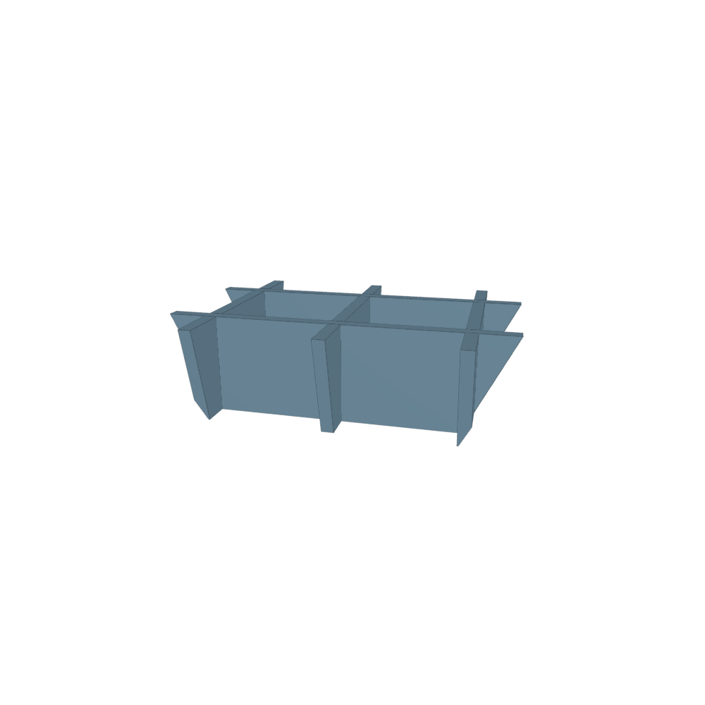

###### Note: Do not edit this file directly, it is automatically generated from the CAD model

# CustomSlicer

## Inputs

- **ShapeToSlice** (geometry)
- **slices_x_axis** (array)
- **slices_y_axis** (array)
- **slice_thickness** (number)

 

